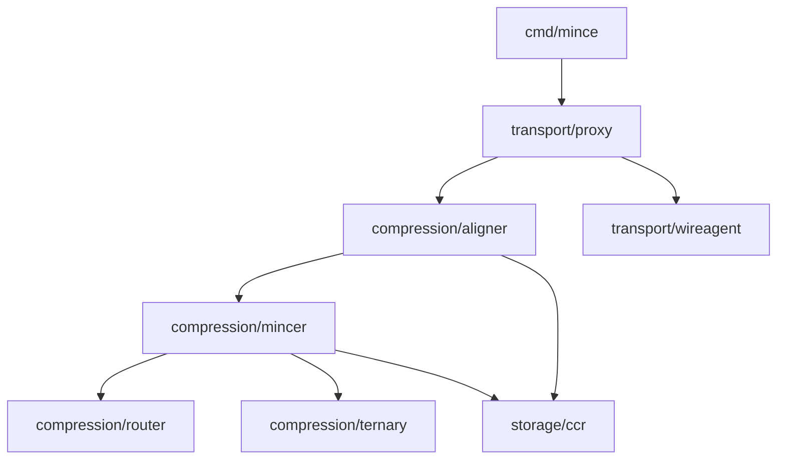

# Architecture

This document describes the code that is present today. The CLI and proxy are
the current product surfaces. Most Go implementation packages are under
`internal`, so downstream Go modules cannot import them as a supported API.

## Package map

```text
cmd/mince/                         CLI and composition root
config/mince.vkd.hcl               Checked-in runtime and capability settings
internal/
  config/                          Shared runtime settings and defaults
    vakedhcl/                      Parses and validates the config file
  compression/
    aligner/                       Finds eligible tool-result content in requests
    mincer/                        Applies content-specific summarizers
    router/                        Classifies JSON, logs, code, or plain text
    ternary/                       Similarity bitboards used by heuristics
  storage/ccr/                     Persists originals and retrieves exact lines
  transport/
    proxy/                         HTTP forwarding and request compression
    wireagent/                     Small request-pipeline transformations
    mcp/                           Stdio JSON-RPC tools
    wrap/                          Starts an agent with a temporary proxy
  felix/                           Bounded-gas language compiler and VM
  litany/                          Capability masks and provenance frames
  pq/                              Exact rational arithmetic
  experimental/
    hf/                            SafeTensors and Kompress salience experiments
    ollama/                        Optional local Ollama client
    rl/                            Policy selection and trajectory logging
    ralph/                         Replay and policy-swap loop
tools/mlx-quant-kompress/          Standalone Rust model exporter
api/openapi.yaml                   Empty starter for a future HTTP API contract
```

Each Go package has a `doc.go` package comment describing its responsibility.

## Active compression request flow


The proxy reads the request body, asks the aligner to locate eligible tool
results, then streams the upstream response to the client. The aligner protects
the configured tail of messages. The mincer classifies eligible text and
selects JSON, log, or code summarization. When it accepts a shortened result,
the original bytes are stored in CCR and the shortened content carries a
retrieval ID. Unsupported requests and results that do not save enough space
pass through.

The proxy also exposes health and stats endpoints. Without a config file, the
CLI enables the tier classifier and inline CCR operations. A config file can
also enable the cache guard. `panic_splice` is not installed because the
current pipeline only processes requests. Other parsed wire-agent settings
remain inactive.

## Other entry points

- `mince compress` and `mince retrieve` call the compression and CCR packages
  directly without starting the HTTP proxy.
- `mince mcp serve` exposes compression, retrieval, stats, and FELIX evaluation
  over stdio JSON-RPC.
- `mince wrap` starts an ephemeral local proxy and launches a child process
  with provider base URLs pointed at it.
- `mince felix eval` compiles and runs a small program in the FELIX VM.
- `mince ralph run` exercises the RALPH policy loop with generated alternating
  rewards; it does not currently replay real agent traffic.

## Experimental or incompletely connected components

- `experimental/hf` contains a SafeTensors reader and integer salience code.
  The active mincer does not load Kompress model weights or call this package.
- `experimental/ollama` is a standalone client and is not called by the active
  compression path.
- The Rust exporter in `tools/mlx-quant-kompress` converts model tensors to its
  own packed format. It is a separate tool and is not invoked by the Go proxy.
- Proxy settings and supported request wire agents in `mince.vkd.hcl` are
  applied when passed with `--config`. Capability budgets, salience model
  declarations, and RALPH policy settings are parsed but not yet connected to
  proxy compression behavior.
- `ralph` and `rl` are reachable through the standalone RALPH command and
  associated code; they do not adapt the proxy's compression policy based on
  observed production requests.

These packages are grouped under `internal/experimental` to make their status
visible in the tree. Their package comments describe that status as well.

## Public Go library direction

There is not yet a public Go package contract. A future library API should
provide a supported facade for compression and retrieval, keep the individual
summarizers and storage details private, and be used by both the CLI and proxy.
The module path and API stability policy need to be settled before downstream
projects can depend on it.

The OpenAPI starter under `api/` is for a future HTTP API and intentionally
defines no operations. Swagger UI is included in Docker Compose for previewing
that document; it does not turn the Go package into an HTTP service.
